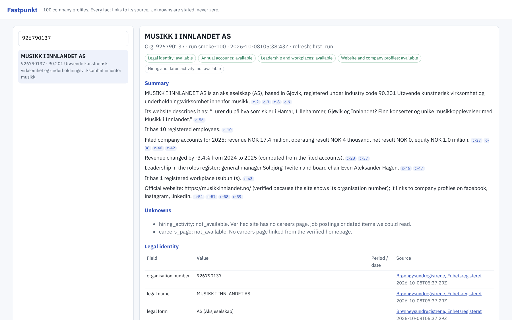

# Fastpunkt

Fastpunkt is a research agent for Norwegian companies, built for the Builderr Signalpost challenge (Round 1). It takes an organisation number and returns one profile, called an envelope. Each published fact in the envelope links to its source and records the retrieval time. Missing data gets an explicit state.

The design rule is evidence first. Official registers are the identity anchor. A company website is published only when there is hard proof that it belongs to this legal entity. A language model never writes a fact. TypeSafe Jev is used only to *select* among candidates that the code found on a page, such as a link, a sentence or a job title, or to return a calibrated yes/no probability. Every published value is copied from the source.

## Run it

You need Python 3.12 or newer and no other services. Run one command:

```bash
./run.sh organisations.jsonl out
```

The input is one organisation number per line, either as plain text or as JSON with an `organisation_number` (or `orgnr`) field. The command writes:

- `out/envelopes.jsonl`: exactly one terminal envelope per input line, in input order
- `out/report.json`: requests, timings, cost and section states
- `out/viewer.html`: a single-file viewer with search, summaries, claim chips and source links

Snapshots are kept in `./store` (or `$FASTPUNKT_STORE`) for refresh and change detection.

The same run without the wrapper:

```bash
python3 -m venv .venv && .venv/bin/pip install -r requirements.txt
.venv/bin/python -m fastpunkt run --organisations organisations.jsonl \
  --output out/envelopes.jsonl --report out/report.json --store store
.venv/bin/python -m fastpunkt render --input out/envelopes.jsonl --output out/viewer.html
```

### Options

| Option | Default | Meaning |
|---|---|---|
| `--max-requests` | 2000 | Hard cap on outbound HTTP requests for the whole batch |
| `--time-budget-min` | 45 | Wall-clock budget. Research stops 45 s before it, and every input still gets an envelope. |
| `--per-company-cap` | 14 | Request cap per company, lowered automatically to fit `remaining requests / companies` (minimum 2) |
| `--workers` | 8 | Companies researched in parallel. Each host gets at most one request every 0.6 s. |
| `--max-typesafe-calls` | 3000 | Hard cap on paid model calls |
| `--no-typesafe` | off | Keyword rules only. Websites without hard identity evidence stay unpublished. |
| `--shallow` | off | Homepage only: no careers or news pages and no subunits |
| `--record DIR` / `--replay DIR` | | Save every HTTP and model response, or answer from a saved set offline |

### Secrets

The only secret is `TYPESAFE_API_KEY`. It is read from the environment, sent only to `api.typesafe.ai` and never written to any output, log or fixture. Without the key the agent still runs: registry sections are unaffected, and only websites with an organisation number on the page or a registry listing are published.

## What it collects

| Section | Source | Fields |
|---|---|---|
| Legal identity | Enhetsregisteret (`data.brreg.no/enhetsregisteret/api/enheter`) | Name, legal form, addresses, industry code, registration and founding dates, registered employees, VAT and business-register status, bankruptcy, liquidation and forced dissolution, share capital, former names, and the website, email and phone listed in the registry |
| Annual accounts | Regnskapsregisteret (`data.brreg.no/regnskapsregisteret/regnskap/{orgnr}`) | Revenue, operating result, result before tax, net result, total assets, equity, total debt, cash and audit opt-out, plus the group (KONSERN) figures where filed. Each claim carries its reporting period and journal number. |
| Leadership and workplaces | Roles endpoint and subunit register | CEO, board chair, board members, business manager, accountant, auditor (names only, never birth dates), registered workplaces |
| Website and profiles | The company's own verified website | Official website, title, the company's own description (verbatim), social profile links, email and phone on the site |
| Hiring and dated activity | The verified site's careers and news pages | Careers page, job postings (JSON-LD `JobPosting` or links chosen by TypeSafe), job count, recruiting-system links, dated news items |

Derived signals come from filed figures only and cite both source claims. They are year-on-year revenue change and negative equity. The summary is template-built, and every sentence lists the claim ids it rests on.

### How a website gets published

Candidates come only from the registry website field, the registry email domain (free-mail providers excluded) and up to two `.no` domains derived from distinctive name tokens. No search engine is used. A candidate is published as `official_website` only when one of these holds:

1. **orgnr_on_site:** the site shows this organisation number in its text or JSON-LD (homepage, contact page or about page).
2. **registry_listed:** the Brønnøysund register lists the site for this entity.
3. **name_match_and_typesafe_identity:** the site names the company, shows no other organisation number, and TypeSafe returns P(same entity) ≥ 0.9.

If none holds, the candidate is listed under `website_candidates` with status `ambiguous` and nothing is published. A registry-listed site can show another organisation number, or show neither this company's name nor its number. Franchise shops listing a chain's site are one example. In that case the link is published with a `relationship` label, and the site's description, contacts, profiles and jobs are not attributed to the company (state `ambiguous`).

### Availability states

Every section and every checked field uses `available`, `not_available`, `blocked`, `not_applicable`, `ambiguous` or `failed`, with a reason. Absence is never turned into zero. `job_postings_count: 0` appears only when a careers page was fetched and contained no specific opening. An invalid organisation number (MOD11 check) gets a `not_applicable` envelope. A budget stop or source error gets `failed` with the error text.

### Refresh and history

Each envelope's material content is hashed into a snapshot id. Every snapshot is stored once under `store/<orgnr>/<snapshot>.json`, and `store/<orgnr>/history.jsonl` is append-only. A second run on unchanged sources reports `unchanged` and writes nothing new. A change, such as a new CEO, new accounts, a new website or a changed address, is listed under `changes` with old value, new value and claim ids. A section that failed in one run is never reported as a removal. The `refresh` block in every envelope names the previous run and snapshot.

## Source rights and outbound URL policy

- **Brønnøysundregistrene:** open data under NLOD 2.0 (Norwegian Licence for Open Government Data). Attribution is recorded in each evidence item.
- **Company websites:** only sites tied to the company as described above. `robots.txt` is fetched and obeyed for the agent's user agent (`FastpunktBot/0.1 (+https://github.com/Ritesist/fastpunkt; ...)`). Disallowed pages are reported as `blocked`.
- **Not used:** LinkedIn, Meta, Glassdoor, Indeed, Google or any other platform scraping, and no search engines. Social profiles are recorded only as links found on the verified company site. Their content is not fetched.
- **URL safety:** every request and every redirect hop is checked separately. The rules are:
  - only `http`/`https`, on ports 80 and 443
  - no embedded credentials
  - the host must resolve to a public IP address; private, loopback, link-local and reserved ranges are refused
  - at most 5 redirects
  - responses are capped at 2 MB, with a 12 s timeout
  - one request every 0.6 s per host
- **Sandbox note:** in a test environment whose DNS answers every name with a synthetic address in 198.18.0.0/15, set `FASTPUNKT_FAKE_IP_DNS=1`. All other checks stay on. Do not set it in a normal network.

## Models, APIs and cost

| Service | Use | Price |
|---|---|---|
| Brønnøysund open APIs | Identity, accounts, roles, subunits | Free |
| TypeSafe Jev `jev-1.13.0` (`api.typesafe.ai/v1/systemone`) | Selection only: website identity (calibrated yes/no), choosing careers, news, about and contact links, choosing a description sentence, classifying job-link candidates | USD 0.042 per million input tokens; output tokens are free |

The model version is pinned because the 0.9 identity threshold was set on it. Override it with `FASTPUNKT_TYPESAFE_MODEL`.

**Expected cost per official batch:** USD 0.009 per 100 companies was measured in the smoke test, which is about USD 0.09 for 1,000 companies. The hard upper bound is `--max-typesafe-calls 3000` × the 64k-token context limit, which comes to USD 8.06, below the USD 10 limit. There are no other paid services.

## Results

These are real live runs on 8 October 2026 over the 100-company smoke set. The set was made with the starter kit's `select_entry_batch.py` (seed 20260823) from the official 411,160-company universe and is saved as `tests/fixtures/smoke-companies-100.jsonl`. Full details are in [`docs/SMOKE_TEST_REPORT.md`](docs/SMOKE_TEST_REPORT.md). Raw outputs are in `results/smoke-100/` (envelopes, report and viewer) and `results/smoke-100-refresh/`.

| | First run | Refresh run (same store) |
|---|---|---|
| Terminal envelopes | 100 / 100 | 100 / 100 |
| Outbound requests (budget 2,000) | 548 | 546 |
| Wall time (budget 45 min) | 181.6 s | 181.9 s |
| Per-company p50 / p95 | 12.6 s / 23.4 s | 13.2 s / 25.2 s |
| TypeSafe calls / cost | 28 / USD 0.0088 | 27 / USD 0.0085 |
| Claims, all states | 5,104 | 5,104 |
| Available claims without evidence | 0 | 0 |
| Refresh status | 100 first_run | 100 unchanged, 0 material changes |

Section states in the first run:

| Section | available | not_available | ambiguous | failed |
|---|---|---|---|---|
| Legal identity | 100 | 0 | 0 | 0 |
| Annual accounts | 100 | 0 | 0 | 0 |
| Leadership and workplaces | 100 | 0 | 0 | 0 |
| Website and profiles | 8 | 64 | 21 | 7 |
| Hiring and dated activity | 0 | 97 | 3 | 0 |

How to read these numbers:

- Only 7 of the 100 companies list a website in the registry and 25 list an email address, so website coverage is low by nature.
- **Published websites:** 3 were verified by the organisation number on the site and 5 by the registry listing. 3 of those 5 carry a brand, franchise or group label, for example a 7-Eleven franchisee whose registry entry points to the chain's site.
- **Ambiguous candidates:** 21 sites were found but not published, because the identity check did not confirm them (TypeSafe P(same entity) between 0.03 and 0.87).
- **Refresh:** the second run produced the same snapshot for all 100 companies. One candidate (WEDO AS) moved from `ambiguous` to `not_available` because its guessed domain did not answer the second time. Nothing had been published for it, so no change was reported.
- **Development run:** an earlier run, before the fix in commit `ddb0912`, reported 2 false "changes", because the model picked a different but equally valid description sentence. The fix keeps a published sentence while it is still on the page verbatim and sets a confidence floor for new choices.



## Tests

```bash
.venv/bin/pip install -r requirements-dev.txt
.venv/bin/python -m pytest -q
```

There are 21 tests, and all run offline:

- **13 unit tests:** MOD11 validation, organisation-number mentions and number boundaries, refused unsafe URLs, budget enforcement, candidate ordering with free-mail exclusion, page extraction (social links, contacts, jobs, dates), detecting another organisation number on a page, distinctive-token name matching, missing values as states rather than zero, and signals and summary computed from claims.
- **8 replay tests:** six real companies plus one invalid number, answered from recorded live responses in `tests/fixtures/replay/`. They cover:
  - the envelope contract
  - resolvable evidence for every available claim
  - reporting periods, and no birth dates
  - the website identity gate
  - brand and group site labelling
  - idempotent refresh
  - CEO-change detection

## Limitations

- Website discovery does not use a search engine, so companies whose site is not listed in the registry, not on their email domain and not at a name-derived `.no` domain get `not_available`. This trades recall for zero wrong-company websites.
- No external job boards are used, so hiring signals come only from careers pages on verified company sites. Most small companies do not have one.
- Accounts come from the Regnskapsregisteret API, which returns the latest filed years. Older history needs the bulk copies, which are not used.
- The 0.9 identity threshold was set by hand on a small set of development companies, not on a large labelled set.
- When the outbound-request budget is tight, for example 2,000 requests for 1,000 companies, the per-company cap drops to 2. Registry identity (batched, 100 per request), accounts and roles are kept. Website research is then reported as `failed` with a budget reason.

## AI disclosure

The code, tests and documentation were written with an AI coding assistant (Grok Bot) and reviewed and run by the author. At runtime, the only model is TypeSafe Jev, used for selection as described above. It never generates published text.

## Licence

MIT. Registry data in outputs remains under NLOD 2.0.
